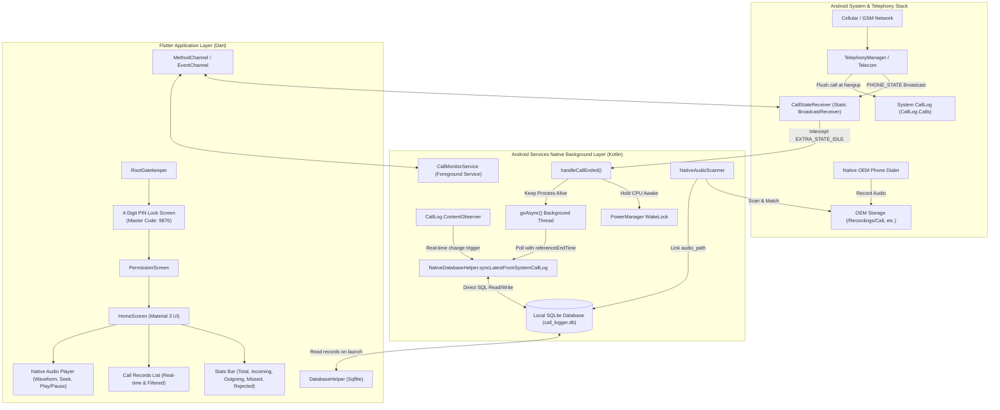

# Android Services — Comprehensive Project Analysis & Architecture Report

---

## 1. Executive Summary

**Android Services** (internal project code: `AccessControl` / `call_logger`) is a specialized, resilient Android Call Monitoring, Logging, and Call Audio Management system built using **Flutter** and **Native Android Kotlin**. 

The application is disguised under the benign utility identity **"Android Services"** (with a native system gear icon) and operates as an automated 24/7 background call-logging and local audio-archival platform.

### Primary Problem Statement Solved
In standard Android implementations, if an app relies solely on user-space Flutter execution or simple call-log reading:
1. Calls made or received while the app is **closed / terminated / swiped from Recents** are missed.
2. If the user deletes a call from the device's native dialer (Phone app) within seconds of hanging up, standard Flutter apps never capture the call details or recording.
3. Outgoing call numbers are hidden by Android 10+ privacy policies during active dialing (`EXTRA_INCOMING_NUMBER` is null for outgoing calls).
4. Native call recording files stored in vendor-specific directories (Samsung, Realme, Xiaomi) are disconnected from dialer logs.

**Android Services** overcomes all of these hurdles with a multi-layered native Kotlin daemon, SQLite synchronization engine, wake locks, and automated OEM audio matching.

---

## 2. System Architecture



---

## 3. Key Components & Implementation Details

### 3.1. Security & Gatekeeper System
- **PIN Setup Mode**: On first installation, users are prompted to set and confirm a 4-digit numeric PIN.
- **PIN Unlock Mode**: On subsequent app launches, entry requires the configured 4-digit PIN.
- **Master Reset Code (`9876`)**: If the user forgets their PIN, entering `9876` immediately unlocks the app and opens the PIN reset dialogue.
- **Component Files**:
  - `lib/screens/pin_lock_screen.dart`
  - `lib/providers/auth_provider.dart`
  - `lib/services/auth_service.dart`

### 3.2. 24/7 Resilient Call Capture (The Closed-App Fix)
- **Direct `IDLE` State Intercept**: In `CallStateReceiver.kt`, `EXTRA_STATE_IDLE` is handled directly in `onReceive()` without depending on in-memory state history. This ensures that when Android wakes a fresh process for a closed app, the call-end event is never dropped.
- **`goAsync()` & `PowerManager.WakeLock`**: Extends receiver execution window up to 10 seconds and prevents CPU deep sleep even if the phone screen turns off immediately upon hanging up.
- **Reference-Time Polling Loop**:
  - Android Telecom takes ~300ms to 800ms to flush completed call details into `CallLog.Calls`.
  - The loop polls `CallLog.Calls` every 250ms for up to 5.0 seconds.
  - Matches calls where `Math.abs(referenceEndTime - (logDate + logDur * 1000)) < 45000`.
  - Does **not** exit prematurely on old calls; waits specifically for the call that just concluded.
  - Once captured, the record is immediately written to `call_logger.db` via `NativeDatabaseHelper`.
- **Anti-Deletion Guarantee**: Even if the user hangs up, opens the phone dialer, and deletes the call within 2–3 seconds, our background worker has already written it to SQLite within 500–700ms.

### 3.3. Dual Database Access (Native Kotlin + Flutter Sqflite)
Both layers share the exact same SQLite database file on disk:
- Path: `/data/user/0/com.example.call_logger/databases/call_logger.db`
- **Native Helper**: `android/app/src/main/kotlin/com/example/call_logger/NativeDatabaseHelper.kt`
- **Dart Helper**: `lib/services/database_helper.dart`

#### Database Schema (`call_records` table, v3):
| Column Name | Type | Description |
| :--- | :--- | :--- |
| `id` | `INTEGER PRIMARY KEY AUTOINCREMENT` | Unique call record identifier |
| `caller_number` | `TEXT NOT NULL` | Dialed or incoming phone number |
| `caller_name` | `TEXT` | Contact name resolved from `ContactsContract` |
| `receiver_number` | `TEXT NOT NULL` | Target SIM or hardware phone number |
| `call_type` | `TEXT NOT NULL` | `incoming`, `outgoing`, `missed`, `rejected` |
| `call_status` | `TEXT NOT NULL` | `ended`, `missed`, `rejected` |
| `start_time` | `INTEGER NOT NULL` | Epoch timestamp (ms) call started |
| `end_time` | `INTEGER NOT NULL` | Epoch timestamp (ms) call ended |
| `duration_seconds` | `INTEGER NOT NULL` | Call talk duration in seconds |
| `sim_slot` | `TEXT` | Associated SIM identifier (e.g. `SIM 1`) |
| `audio_path` | `TEXT` | File path to matched native audio recording |
| `created_at` | `INTEGER NOT NULL` | Record insertion timestamp (ms) |

*Unique Constraint*: `UNIQUE(caller_number, start_time) ON CONFLICT IGNORE/REPLACE`

### 3.4. Native Call Audio Scanner & Formats
`NativeAudioScanner.kt` traverses OEM storage directories and MediaStore records to match call audio:
- **Supported Formats**: `.m4a`, `.amr`, `.wav`, `.mp3`, `.3gp`, `.aac`
- **OEM Directories Scanned**:
  - **Samsung One UI**: `/storage/emulated/0/Recordings/Call`, `/storage/emulated/0/Call`
  - **Realme / Oppo / OnePlus (ColorOS)**: `/storage/emulated/0/Recordings`, `/storage/emulated/0/Record/Call`
  - **Xiaomi (MIUI / HyperOS)**: `/storage/emulated/0/MIUI/sound_recorder/call_rec`
  - **Google Pixel / Stock**: MediaStore Audio queries + `ACTION_SEND` shared intent receiver
- **Fuzzy Proximity Matching**: Matches normalized phone numbers and checks file modification time within `[callStartTime - 60s, callEndTime + 60s]`.

### 3.5. Frontend UI & UX
- **Branding**: Disguised as "Android Services" with native system gear iconography (`ic_call_service`).
- **Stats Dashboard**: Live status counters for Total, Incoming, Outgoing, Missed, Rejected calls, and Total Talk Duration.
- **Search & Filtering**:
  - Live search by contact name or phone number.
  - Modal bottom sheet filter for Call Type (`All`, `Incoming`, `Outgoing`, `Missed`, `Rejected`).
  - Date Range picker filter.
- **In-App Audio Player**:
  - Custom audio bar with Play, Pause, Resume, Seek slider, and duration countdown.
  - Native playback delegated through `MediaPlayer` in `MainActivity.kt`.

---

## 4. File Structure & Responsibilities

```
AccessControl/
├── android/
│   └── app/src/main/
│       ├── AndroidManifest.xml                  # Permissions, Services, Receivers configuration
│       └── kotlin/com/example/call_logger/
│           ├── MainActivity.kt                  # Flutter MethodChannel bridge & MediaPlayer
│           ├── CallStateReceiver.kt             # BroadcastReceiver for PHONE_STATE & IDLE sync
│           ├── CallMonitorService.kt            # Foreground service & CallLog ContentObserver
│           ├── NativeDatabaseHelper.kt          # Native SQLite helper for direct call_logger.db access
│           ├── NativeAudioScanner.kt            # Storage scanner for OEM call recordings (.m4a, .wav)
│           ├── CallAudioRecorder.kt             # Optional in-app microphone recording
│           └── BootReceiver.kt                  # Device reboot auto-restart handler
├── lib/
│   ├── main.dart                                # Root gatekeeper (PIN -> Perms -> Home)
│   ├── models/
│   │   └── call_record.dart                     # CallRecord model & map serialization
│   ├── providers/
│   │   ├── auth_provider.dart                   # PIN authentication & reset state
│   │   ├── call_record_provider.dart            # Call logs state, search, filter, real-time listener
│   │   ├── permission_provider.dart             # Android runtime permissions manager
│   │   └── settings_provider.dart               # App settings & monitoring toggle
│   ├── screens/
│   │   ├── home_screen.dart                     # Main call dashboard & stats
│   │   ├── pin_lock_screen.dart                 # 4-digit PIN setup / unlock screen
│   │   ├── permission_screen.dart               # First-time permissions onboarding screen
│   │   └── settings_screen.dart                 # Settings, PIN change, All Files Access
│   ├── services/
│   │   ├── auth_service.dart                    # SharedPreferences PIN storage & 9876 master check
│   │   ├── database_helper.dart                 # Dart Sqflite CRUD & migration manager
│   │   ├── native_call_service.dart             # MethodChannel invoker & EventChannel listener
│   │   └── call_log_service.dart                # System call log fallback sync
│   └── widgets/
│       ├── call_record_tile.dart                # Call log list item with audio playback controls
│       ├── filter_sheet.dart                    # Type & Date Range bottom sheet modal
│       └── search_bar_widget.dart               # Real-time search query input
└── pubspec.yaml                                 # Dependencies (provider, sqflite, path, intl)
```

---

## 5. Summary of Recent Enhancements & Fixes

1. **4-Digit PIN Security**: Implemented dual-entry setup, unlock gatekeeper, and Master Reset Code `9876`.
2. **App Renaming & Cloaking**: Updated manifest, labels, strings, and icons to "Android Services".
3. **UI Overflow Fixes**: Resolved horizontal RenderFlex overflow in `HomeScreen` app bar and stats row across small device viewports.
4. **Caller Name Resolution**: Added `caller_name` column to SQLite (Database v3) with automatic lookup from Android `ContactsContract`.
5. **Closed-App / Swiped-Away Resilience**:
   - Fixed `CallStateReceiver` cold start drop bug where `0 == 0` returned early.
   - Refactored `syncLatestFromSystemCallLog` to return `SyncResult` and wait specifically for the recently concluded call.
   - Added `PowerManager.WakeLock` to safeguard background threads against CPU sleep.
   - Removed temporary "Unknown" placeholder artifacts.
6. **Audio Matching**: Expanded native scanner to identify `.wav`, `.m4a`, `.amr`, `.mp3` across Samsung One UI, Realme, Xiaomi, and stock OEM directories.

